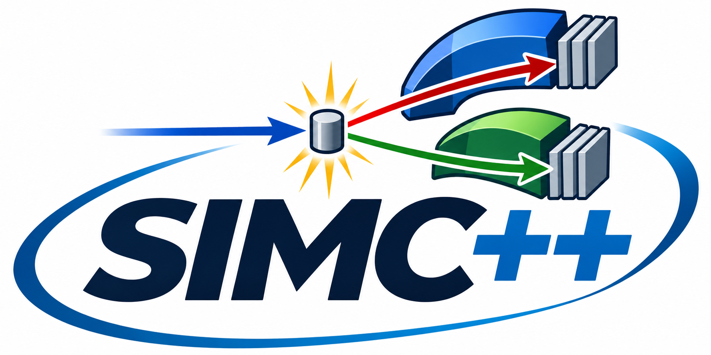

<p align="center"></p>

# SIMC++

SIMC++ is a C++20 / ROOT 6 translation of SIMC (Fortran, `simc_gfortran`), the Monte Carlo simulation of electron-scattering experiments with magnetic spectrometers. It reads
the Fortran `.inp` files unchanged, and it writes the Fortran `.hist`/`.geni`/`.gen` reports and the `h10` ROOT tree.
Every stage of the event chain is a plug-in that can be chosen from a JSON configuration. Every reaction, spectrometer and
the polarized-target field of the Fortran are ported. Clear Fortran bugs are corrected by default; `--fortran-compat`
restores the exact Fortran behaviour, and with the RANLUX generator SIMC++ then reproduces Fortran runs file for file.

## Features

- **Reactions:** H(e,e'p) elastic, D/A(e,e'p) quasi-elastic (spectral functions, Benhar SF), exclusive pion (π±, π0 → 2γ, Δ final states, coherent), kaon (Λ, Σ0, Σ−, hypernuclei), Delta, SIDIS, exclusive ρ0, and phase-space mode.
- **Spectrometers:** HMS, SHMS, SOS, HRS-L/R and NPS-type calorimeter arms; spectrometer Monte Carlo on/off per arm (`spect_mode`); polarized-target field tracking.
- **Physics chain:** beam and target (energy loss, multiple scattering, raster), radiative corrections, decay in flight, COSY transport, apertures and reconstruction, normalisation.
- **Inputs and outputs:** classic SIMC `.inp` files read as they are, or JSON (which can also choose the plug-ins); `.hist`/`.geni`/`.gen` reports, the `h10` ROOT tree and a JSON run summary.
- **Validated against the Fortran:** with `--fortran-compat` and the RANLUX generator, every shipped input the Fortran can run (39/39) is reproduced file for file; 440+ tests.
- **Fast:** single-threaded faster than the Fortran; optional `--threads N` with reproducible streams.
- **Extensible:** every stage is a plug-in; an installable CMake package lets you build new reactions or spectrometers out of tree.

## Status

The translation is complete (all reactions and spectrometers of the Fortran). The code is maintained and will evolve: the
Fortran findings still open for physics experts (Category B and C in
[the findings list](docs/translation/markdown/FORTRAN_DIFFERENCES.md)) may lead to further corrections.

## Manuals

* **[User manual](docs/manual/markdown/user/index.md)**: installation, quick start, inputs (complete parameter reference),
  reactions, spectrometers, outputs, run modes and reproducibility, performance, FAQ.
* **[Developer manual](docs/manual/markdown/developer/index.md)**: build, architecture, stage interfaces, extending SIMC++, parallel mode, coding standards.
* **[Translation report](docs/translation/markdown/index.md)**: how the Fortran was translated and validated, the routine map, and the catalogue of every Fortran bug and quirk found.
* **API reference (Doxygen):** `cmake --build $SIMCPP_BUILD --target doc` → `$SIMCPP_BUILD/docs/doxygen/html/index.html`.

Ready-made PDFs: [User Manual](docs/manual/pdf/SIMCpp_User_Manual.pdf), [Developer Manual](docs/manual/pdf/SIMCpp_Developer_Manual.pdf), [Translation Report](docs/translation/pdf/SIMC_Fortran_to_SIMCpp_Translation_Report.pdf), [API Reference](docs/doxygen/pdf/SIMCpp_API_Reference.pdf).

Every book has a Markdown edition (read it here) and a LaTeX edition (`docs/manual/latex/`, `docs/translation/latex/`,
both editable sources): `cmake --build $SIMCPP_BUILD --target pdf` (needs XeLaTeX) writes the user manual, the developer
manual and the translation report as PDF books into `$SIMCPP_BUILD/docs/`. [docs/README.md](docs/README.md) maps the
documentation tree and explains how to edit and build each edition.

Translation and validation (comparison with the Fortran SIMC, every difference): `docs/translation/`, with the user
guides [docs/translation/markdown/user_comparing_with_fortran.md](docs/translation/markdown/user_comparing_with_fortran.md) and
[docs/translation/markdown/user_differences.md](docs/translation/markdown/user_differences.md). Reference documents: [docs/manual/markdown/reference/INP_JSON_MAPPING.md](docs/manual/markdown/reference/INP_JSON_MAPPING.md), [docs/manual/markdown/reference/OUTPUT_FORMAT.md](docs/manual/markdown/reference/OUTPUT_FORMAT.md),
[docs/translation/markdown/FORTRAN_DIFFERENCES.md](docs/translation/markdown/FORTRAN_DIFFERENCES.md), [docs/manual/markdown/reference/DRIVER.md](docs/manual/markdown/reference/DRIVER.md),
[docs/manual/markdown/reference/ARCHITECTURE.md](docs/manual/markdown/reference/ARCHITECTURE.md), [docs/manual/markdown/reference/EXTENDING.md](docs/manual/markdown/reference/EXTENDING.md),
[docs/manual/markdown/reference/PERFORMANCE.md](docs/manual/markdown/reference/PERFORMANCE.md), [validation/README.md](validation/README.md).

**Delta-region runs (`doing_delta`) have no cross section in the weight**, as in the Fortran (`physics_delta.f:132`):
their yields are not physical rates.

## In short

```bash
export SIMCPP_SRC=~/src/simcpp SIMCPP_BUILD=~/build/simcpp ROOTSYS=~/opt/root LD_LIBRARY_PATH=~/opt/root/lib
cmake -S $SIMCPP_SRC -B $SIMCPP_BUILD -DCMAKE_PREFIX_PATH=$ROOTSYS -DCMAKE_BUILD_TYPE=Release
cmake --build $SIMCPP_BUILD -j8
$SIMCPP_BUILD/bin/simc++ $SIMCPP_SRC/docs/manual/markdown/user/examples/h_elastic_rad.inp -o out --ngen 5000
(cd $SIMCPP_BUILD && ctest -L docs)
```

The Fortran SIMC is not needed. Requirements: a C++20 compiler, CMake ≥ 3.15, ROOT ≥ 6.40 built with C++20, nlohmann/json ≥ 3.9 (fetched if absent).
See [chapter 2 of the user manual](docs/manual/markdown/user/02_installation.md) for the options, installation, data directory and
test labels.

## Layout

```
include/simc/, src/   the library (core, stages, driver, reactions, physics, optics, spectrometers, output)
tools/                simc++ main, inp2json, hist2json, check_all.sh, check_md_links.py
tests/                unit/ l1/ fortran_diff/ regression/ user_manual/
validation/           simc_compare (statistical comparison with the Fortran) and validation scripts
examples/             example plug-ins
data/                 COSY maps, model tables, spectral functions, field map, example configurations
docs/                 manual/ (user, developer, reference), translation/, doxygen/, common/ (LaTeX style, logo); docs/README.md
```

## License

MIT License.

Original Fortran SIMC by the Hall C collaboration.
C++ port by Carlos.

## Acknowledgments

- Hall C collaboration for the original Fortran SIMC
- Jefferson Lab for detector specifications and test data
- ROOT team for the framework
