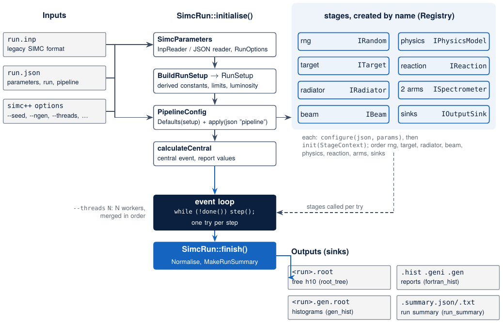
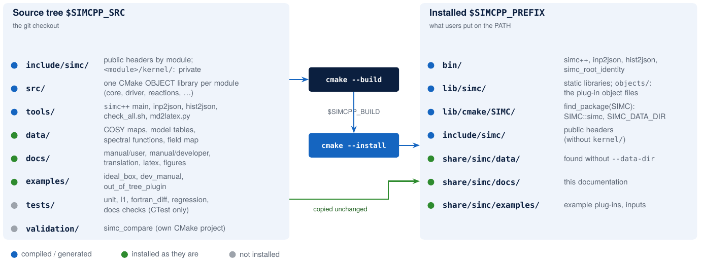

# 1. Overview

## 1.1 What SIMC++ is

SIMC++ is a C++20 / ROOT 6 Monte Carlo for coincidence (e,e'X) experiments in Hall C (and Hall A / NPS-like
detector configurations): it generates events for a reaction, propagates the particles through the target and the
spectrometers, reconstructs them, weights them with a cross-section model and writes ROOT trees, histograms and text
reports.

SIMC++ originates from the Fortran SIMC (`simc_gfortran`): its physics and its numerical results reproduce that program,
and its text outputs keep the Fortran formats. How the translation was done and validated, the routine-by-routine map,
the numerical rules for bitwise fidelity and the catalogue of every Fortran bug and quirk are in the separate
**[translation report](../../translation/index.md)**. This manual is about the SIMC++ framework itself.

## 1.2 The framework in one page

* **A run** is a `driver::SimcRun`: it reads the input (`.inp` or JSON) into `SimcParameters`, builds the derived run
  constants (`RunSetup`), creates the **stages** of the run by name, computes the central event, loops over tries
  (`step()`), and finally normalises and writes the outputs (`finish()`).
* **Stages are plug-ins.** Every replaceable piece of the event chain is an abstract interface in
  `include/simc/stages/`: random source (`IRandom`), target (`ITarget`), material (`IMaterialModel`), beam (`IBeam`),
  reaction (`IReaction`), cross-section model (`IPhysicsModel`), spectral function (`ISpectralFunction`), radiative
  corrections (`IRadiator`), spectrometer arm (`ISpectrometer`) and outputs (`IOutputSink`). Implementations register a
  name (`SIMC_REGISTER`) and are chosen from the JSON `pipeline` section. The driver depends only on the interfaces.
* **Dependencies are injected** at `init()` through a `StageContext` (the run set-up and the collaborators: target,
  radiator, physics model).
* **Kernels and stages.** The numerical core consists of *kernels*: functions and classes that implement the physics
  algorithms exactly (operation order, random-number order), some of them with internal state in `kernel/` headers that
  are private to their module. *Stages* are the clean classes around them that implement the interfaces.
* **Events** are value types (`Event`, `MainEvent`) held in one `EventState` for the whole run; fields that a try does not
  rewrite keep their previous values, which is part of the defined behaviour (chapter 3 §3.4).
* **Outputs** are sinks: the ROOT tree, the run summary JSON, the generated histograms and the text reports.
* **Parallel event loop**: `--threads N` runs N independent workers with their own stages and random streams and merges
  their results in a fixed order (chapter 5).
* **Validation** is part of the build: unit tests, routine-level reference tables, full-run identity tests, regression
  baselines and a statistical comparison tool (chapter 2 §2.5; methodology in the translation report).



## 1.3 Design principles

1. **Everything is a plug-in** chosen by name from the JSON pipeline; a plug-in has exactly the possibilities of a
   built-in stage, in tree or out of tree (chapter 4).
2. **Explicit inputs and outputs, no global state**: RAII and `unique_ptr` ownership, value types for events,
   const-correct interfaces, collaborators through the `StageContext`; every mutable state belongs to an object (which is
   what makes the parallel event loop safe).
3. **Faithful kernels behind clean interfaces**: the numerical code keeps its exact operation order; refactors happen
   around it and are proved by output identity (chapter 6).
4. **One unit convention** (`core/Units.h`): MeV, MeV/c, MeV², cm, rad, g/cm², delta in %, slopes; input and output
   units are converted once, at the borders.
5. **Reproducibility**: a given input, seed and thread count always give the same files.
6. **Two behaviour modes**: the default mode corrects known defects of the original program; the run option
   `fortran_compat` (`--fortran-compat`) restores the original behaviour exactly (chapter 3 §3.7).

## 1.4 Where things are

```
include/simc/core/        parameters, RunSetup, events, Registry, Errors, Units, constants, random sources
include/simc/stages/      the stage interfaces and StageContext
include/simc/<module>/    plug-in classes and kernel libraries; <module>/kernel/ = private headers
src/<module>/             one CMake target per module
src/driver/               SimcRun, MonteCarlo, reports, pipeline, command line
tools/                    simc++ main, inp2json, hist2json, check_all.sh, check_md_links.py
examples/                 ideal_box (in tree), dev_manual (this manual's examples), out_of_tree_plugin
tests/                    unit, l1, fortran_diff, regression, user_manual, developer_manual
validation/               simc_compare (own CMake project) and scripts
data/                     model tables, optics maps, spectral functions, field map
docs/                     reference documents, manual/user, manual/developer, translation
```


