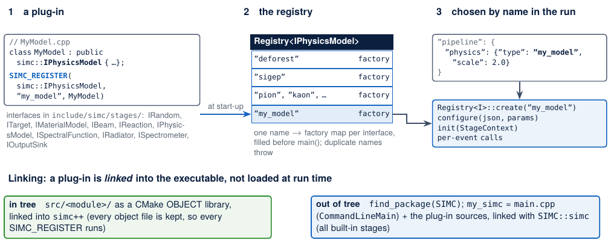
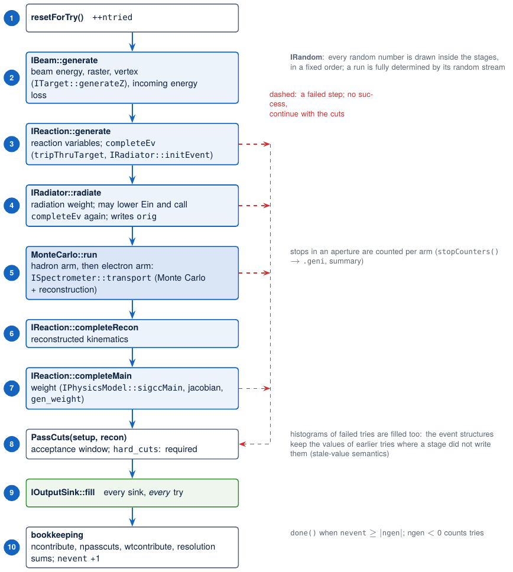
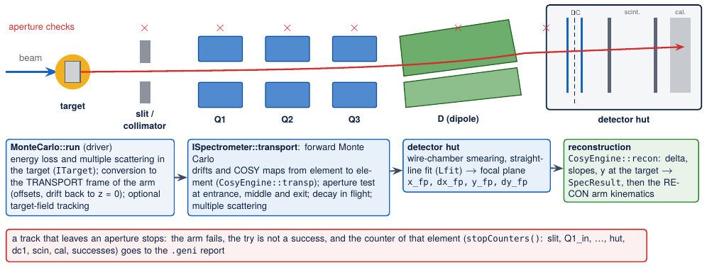

# 3. Architecture and data flow

The short reference is [ARCHITECTURE.md](../reference/ARCHITECTURE.md) (layers, stage table, wiring); the stage contracts with
code are in [EXTENDING.md](../reference/EXTENDING.md). This chapter explains how the pieces work together and ends with a
reference of every public header.

## 3.1 Layers

```
 tools        simc++ (CommandLineMain), inp2json, hist2json, simc_root_identity     validation/ simc_compare
 driver       SimcRun, MonteCarlo, PizeroCalorimeter, Central, RunReport, Pipeline, sink fortran_hist
 io           input/  InpReader, EffectiveValues          output/  RootTreeSink, GenHistSink, RunSummarySink,
                                                                   NtupleLayout, SummaryJson
 plug-ins     material/HallCCryoTarget, SimcMaterial   radiation/SimcRadiator   reactions/*   physics/*
              spectrometers/*/<Name>Spectrometer   examples/
 kernels      radiation/kernel   spectrometers/*/kernel   optics (CosyEngine, TargetField, Lfit)
              setup (BuildRunSetup)   reactions/EventChain   physics/* cross-section functions
 stages       include/simc/stages: IStage, StageContext and the interfaces
 core         SimcParameters, RunSetup, Event/MainEvent, RunSummary, Registry, Errors, Units, constants, random
```

A layer uses only the layers below it. The driver includes no plug-in header and never casts a stage to a concrete
class; the only exceptions are optional capability interfaces queried with `dynamic_cast` (`IReportSink`,
`IParallelSink`) and `Mt64Random` in the threads code (it needs the per-worker streams).

**Kernels vs stages.** A *kernel* implements a numerical algorithm exactly (fixed operation order, fixed random-number
order); kernels with internal state (per-run tables, values kept between calls, argument structs, sometimes 1-based
arrays) keep it in members. A *stage* (plug-in) is a clean class implementing an interface from
`include/simc/stages/`; it owns its kernel and adapts it. Kernel headers that expose such internal state live in a
`kernel/` directory (`radiation/kernel/`, `spectrometers/*/kernel/`), are included only by their module, its plug-in and
its tests, and are **not installed**. A plug-in header exposes its kernel at most through an opaque `kernel()` accessor
(pimpl) for the tests. The optics engine, the target field, the set-up builder and the cross-section functions are
kernel libraries shared by several plug-ins; their headers are public.

## 3.2 The registry and the plug-in life cycle

`simc::Registry<Interface>` (core/Registry.h) is a name → factory map per interface (a function-local static, so the
static-initialisation order is safe). `SIMC_REGISTER(Iface, "name", Class)` adds a factory at static-initialisation time
(duplicate names throw `std::logic_error`); `Registry<I>::create(name)` builds an instance (unknown names throw
`std::out_of_range` with the list of known names); `contains`, `names` list them. Registration requires the object
file to be linked (OBJECT libraries, chapter 2 §2.3).

Life cycle of every stage (`IStage`): `create(name)` → `configure(json, params)` (once: the stage's JSON object from the
pipeline merged over the defaults, without `"type"`, plus the raw input `SimcParameters`) → `init(StageContext)` (once:
derived tables and the collaborators) → per-event calls.

**StageContext** (stages/StageContext.h) is the dependency injection: `{const RunSetup& setup; ITarget* target;
IRadiator* radiator; IPhysicsModel* physics}`. It is implicitly constructible from a `RunSetup`, so `stage.init(setup)`
works for stages without collaborators (tests). `requireTarget/requireRadiator/requirePhysics(who)` throw
`std::logic_error` naming the stage when a needed collaborator is missing. A stage keeps the pointers it gets and never
casts them.

**Pipeline** (driver/Pipeline.h): `PipelineConfig` has one `StageSpec {type, config}` per stage (`rng`, `target`, `beam`,
`reaction`, `physics`, `radiator`, `hadron_arm`, `electron_arm`), the list `sinks`, and `threads`.
`PipelineConfig::Defaults(setup)` derives the default choice from the input flags (reaction from the `doing_*` flags,
model from the reaction and target, arms from `electron_arm`/`hadron_arm` through `MonteCarlo::DefaultArm`, sinks
`root_tree` (only if `Nntu > 0`), `run_summary`, `gen_hist`, `fortran_hist`, rng `mt64`). `apply(json)` merges the JSON
`pipeline` section (unknown keys throw). `simc++ --print-pipeline` prints the resolved pipeline.



## 3.3 The driver: SimcRun

`driver::SimcRun` (SimcRun.h/.cpp) is one complete run:

```cpp
SimcRun run(params, pipelineJson, options);   // nothing happens yet
run.initialise();                              // set-up, stages, central event
while (!run.done()) run.step();                // one try per step
run.finish();                                  // normalisation and outputs
// or run.run(): initialise, then the step() loop or runThreaded(N), then finish
```

`RunOptions` (run name, output directory, data directory, ngen/seed overrides, log stream, `quiet_stages`,
`fortran_compat`, `threads`) come from the command line (`driver::CommandLineMain`, CommandLine.cpp; options in
[DRIVER.md](../reference/DRIVER.md)). `setRandom(unique_ptr<IRandom>)` replaces the pipeline rng (tests use a
`ScriptedRandom`), `addSink(unique_ptr<IOutputSink>)` adds a sink created in code.

**`initialise()`**, in this order:

1. builds the `RunSetup`: `BuildRunSetup(params, SetupOptions, startupTarget)` with a *dedicated, unconfigured*
   instance of the pipeline's target as the `ITargetLossProvider` (the start-up energy losses and multiple-scattering
   limits come from the same target model as the event loop). `SetupOptions` carries the data directory,
   `fortran_compat` and the spectral-function file named in `pipeline.reaction.spectral_function` (the set-up reads it
   because it fixes the generation limits). Set-up messages are logged; a fatal set-up condition becomes
   `simc::FortranStop`;
2. resolves the pipeline (`Defaults` + `apply`);
3. creates and initialises the stages in a fixed order, each with `configure` then `init(ctx)`:
   rng → target → radiator → (ctx.target, ctx.radiator set) → beam → physics model → (ctx.physics set) → reaction →
   `MonteCarlo` (creates the two arm spectrometers; arms with the same type and the same merged config share one
   object, i.e. one set of counters) → sinks (registry ones, then the `addSink` ones);
4. `calculateCentral`: `vertex0` from the central spectrometer settings, `completeRecon`, `IReaction::prepareCentral`,
   `IRadiator::initEvent` (the radiation "Central Values" of the report are the radiator's `currentValues()` right after
   it), `completeMain(force_sigcc = true)`;
5. report bookkeeping, `beginRun(setup)` of every sink, the begin time.

**`step()`** = one try:

```
resetForTry()                                   ntup radphot radarm decdist resfac sigcm krel mm mmA t = 0, Mh2_final = Mh2
++ntried; progress line every 1000/20000 tries
IPhysicsModel::beginEvent(nevent); IReaction::beginTry(ntried)      (messages only)
reactions::generateEvent:
   IBeam::generate(main, vertex, rng)           beam energy spread, raster, vertex x/y, z (ITarget::generateZ), incoming
                                                energy loss (ITarget::tripThruTarget arm 1)
   IReaction::generate(main, vertex, orig, rng) reaction variables; completeEv (tripThruTarget arms 2/3,
                                                IRadiator::initEvent); IRadiator::radiate(..., completeEv) or orig = vertex
if ok: MonteCarlo::run(orig, main, recon, rng)  both arms (below)
if ok: IReaction::completeRecon(recon)          reconstructed kinematics
if ok: IReaction::completeMain(false, main, vertex, vertex0, recon)  the weight
pass_cuts = PassCuts(setup, recon)              acceptance window on the reconstructed event (every try)
hard_cuts                                       optional: pass_cuts (and the Em cut) required for success
sum_sigcc += main.sigcc (successes)
IOutputSink::fill(main, vertex, orig, recon, success)   every sink, EVERY try (histograms of failed tries too)
successes: ncontribute, ncontribute_no_rad_proton (IRadiator::hadronRadiates), and if pass_cuts: npasscuts,
           wtcontribute += weight, the resolution sums; reactions::limitsUpdate (IRadiator::photonEnergies)
nevent += 1 for a success (ngen > 0) or for every try (ngen < 0)
```

`done()` is `nevent >= |ngen|`. Every random number is drawn inside the stages, in a fixed order, so a run is fully
determined by its random stream: a `ScriptedRandom` fed with a recorded stream reproduces a run bit for bit.

**`MonteCarlo::run`**: beam multiple scattering (`ITarget::multipleScattering`, teff[0]) when `mc_smear`; then the
**hadron arm first**: spectrometer-frame quantities (energy loss, multiple scattering with teff[2]), conversion to the
TRANSPORT frame (offsets, drift back to z = 0; `SpecInput.fry`, `raster_fry/frx`), optional target-field tracking
(`optics::TargetField::trackFromTgt`), `ISpectrometer::transport`, RECON/FP, optional `trackToTgt` with
`ISpectrometer::reconstructLastTrack`, the reconstructed arm kinematics (physics angles, optional most-probable
energy-loss correction through `tripThruTarget`); then the **electron arm** the same way (Coulomb correction, teff[1],
`decay_flag` false). A failed arm returns at once. Calorimeter hadron arms with `doing_pizero` go through
`driver::PizeroCalorimeter` (two photons, two `calo` calls).

**`finish()`**: `Normalise(setup, totals, reaction.genVolume())`, the stop counters of both arms, the end-of-run target
state (`IReaction::finalTargetState`), `MakeRunSummary`, then for every sink `endRun(summary)` and, if it implements
`IReportSink`, `writeReport(setup, report)`. With `ngen = 0` nothing is written.



## 3.4 Event structures and the stale-value semantics

All in core/Event.h, in the internal units (MeV, MeV/c, cm, rad, delta in %, slopes):

* `Event` (`vertex`, `orig`, `recon`): Ein, Em, Pm, nu, q, Q2, W, epsilon, theta_pq, phi_pq, ..., the arms `e`, `p`
  (`ArmFull`: delta, xptar, yptar, z, theta, phi, E, P) and the unit vectors `ue`, `up`, `uq`.
* `MainEvent`: weight, SF_weight, gen_weight, jacobian, sigcc, sigcc_recon, the CM quantities, the target part
  (`EventTarget`: x, y, z, raster, teff[0..2], Eloss[0..2] for beam / electron / hadron, Coulomb), `SP`, `RECON` (arm
  quantities at the target), `FP` (focal plane), and three per-event blocks: `ntup` (`NtupVars`: ntuple-only quantities
  such as radphot, resfac, sigcm, krel, mm, t, decdist, Mh2_final, π0 photons, rho mass), `pfermi` (the struck
  nucleon's Fermi motion) and `gnrl` + `gnrl_per_event` (the hadron mass when it changes per try: rho).
* `driver::EventState` = `{main, vertex, orig, recon}` plus `success`, `pass_cuts`, `ntried`.

**One `EventState` lives for the whole run and is handed to every stage on every try.** Several stages write only parts
of these structures (`orig` is not written when the radiation fails; the arm transport returns early on a failed arm and
leaves `main.SP/RECON/FP` from an earlier try; ...), and those values reach outputs (pass_cuts and the histograms of
failed tries). State that belongs to one stage (radiation state, spectrometer counters, values kept between calls)
lives inside the stage objects.

> **Warning:** this is defined behaviour, not an accident: never "clean up" by re-creating the event per try;
> `SimcRun::resetForTry` resets exactly the fields listed above.

`RunSetup` (core/RunSetup.h) holds everything derived once before the loop: the raw `params` (input units), `flags`
(`ReactionFlags`: doing_*), the target (`TargetInfo`), spectrometer settings and offsets, cuts (`SPedge`,
`VERTEXedge`), generation limits, slops, radiation constants, histogram axes, luminosity, `fortran_compat`, messages and
`stops`. Units: internal.

## 3.5 Stage interfaces: contracts and call order

Per interface: header, call points, contract. Built-in plug-ins are listed in ARCHITECTURE.md §3.

* **`IStage`** (stages/IStage.h): `name()`, `configure(Json, SimcParameters)`, `init(StageContext)`. Every built-in
  stage understands `"verbose": false` (added by the driver for `--quiet`).
* **`IRandom`** (stages/IRandom.h): `uniform()` in (0,1), `gauss1(nsig_max)` (standard normal truncated at nsig_max by
  rejection), `seed(uint64)`. Called only by the stages, in a fixed order. Implementations: core/random/Mt64Random.h
  (`mt64`, default, `seedStream(seed, k)` for the threads), RanluxRandom.h (`ranlux`, RANLUX luxury 3),
  ScriptedRandom.h (FIFO queues for tests; counts every call; NaN and `error()` when exhausted), Gauss1.h (the
  truncated gaussian on any uniform source).
* **`ITarget`** (stages/ITarget.h) + **`ITargetLossProvider`** (stages/ITargetLossProvider.h): per event
  `generateZ(rng)` (vertex z, cm, including zoffset; called by the beam), `tripThruTarget(arm 1/2/3, z, E, theta,
  mass, LossMode, rng) → {eloss MeV, radlen}` (beam: by the beam; arms 2/3: by `completeEv`; most-probable mode: by
  the arm energy-loss correction), `multipleScattering(p, beta, teff, rng) → {dyptar, dxptar}` (arm transport).
  Start-up: `targetInit(TargetInitArgs, TargetInfo&, messages)` and `extremeLosses(ExtremeTripArgs, TargetInfo&)` are
  called by `BuildRunSetup`; they get everything through their arguments (the provider instance is never configured).
  Plug-in: `hallc_cryo` (material/HallCCryoTarget.h), which uses an `IMaterialModel`.
* **`IMaterialModel`** (stages/IMaterialModel.h): `energyLoss(len, density, zeff, aeff, E, m, typeflag, rng)`,
  `musc(...)`, `muscExt(...)`. Plug-in `simc_material` (material/SimcMaterial.h), selected inside the target's JSON
  (`"material"`).
* **`IBeam`** (stages/IBeam.h): `generate(main, vertex, rng)`: beam spread, raster, vertex x/y/z, incoming energy.
  Called first in every try by `reactions::generateEvent`. Plug-in `standard` (reactions/StandardBeam.h).
* **`IReaction`** (stages/IReaction.h): `generate(main, vertex, orig, rng)` (after the beam: generated variables,
  `completeEv`, then `radiator->radiate(main, vertex, orig, rng, completeEvFn)` or `orig = vertex`; `orig` is written
  only on success of the radiation), `completeEv(main, vertex, rng)` (vertex kinematics, `tripThruTarget` arms 2/3, must
  end with `radiator->initEvent(main, vertex)`; it is also the `CompleteEvFn` that the radiator calls after reducing
  Ein), `completeRecon(recon)`, `completeMain(force_sigcc, main, vertex, vertex0, recon)` (sets `SF_weight`, `sigcc`,
  `sigcc_recon`, `weight` with `ctx.physics`; returns false if the event cannot contribute unless `force_sigcc`),
  `genVolume()` (normalisation). Optional hooks: `prepareCentral(main0, vertex0)`, `finalTargetState(targ)`,
  `beginTry(ntried)`. The (e,e'p) family shares `reactions::EepReactionBase`; pion, kaon, Delta and SIDIS share the
  `PionProduction` plumbing; rho has its own.
* **`IPhysicsModel`** (stages/IPhysicsModel.h): `sigcc(vertex, main)`, `sigccRecon(recon, main)`, `sigccMain(vertex,
  main&)` (for models that also write `main`, e.g. CM angles and jacobians; the reactions call this one; default =
  `sigcc`), `beginEvent(nevent)`. Called by `completeMain` (directly or through `reactions::assembleWeight`), also for
  the central event.
* **`ISpectralFunction`** (stages/ISpectralFunction.h): `weight(vertex)` = SF_weight at (Em, Pm), `file()`. A component of
  the D/A(e,e'p) reactions, created in their `init()` from `reaction.spectral_function`. Plug-ins `theory`, `benhar`
  (physics/nuclear/SpectralFunctions.h).
* **`IRadiator`** (stages/IRadiator.h): `initEvent(main, vertex)` (per-event radiation set-up; called by `completeEv`),
  `radiate(main, vertex, orig, rng, completeEv)` (multiplies `main.gen_weight`, may reduce `vertex.Ein` and re-call
  `completeEv`); read-back `currentValues()` (`RadiationValues`, central values for the report), `photonEnergies()`
  (for `limitsUpdate`), `hadronRadiates()`. Plug-in `simc_rad` (radiation/SimcRadiator.h).
* **`ISpectrometer`** (stages/ISpectrometer.h): `transport(SpecInput, rng) → SpecResult` (the single-arm Monte Carlo:
  input track in the TRANSPORT frame at z = 0, central momentum and angle, mass², smearing and decay flags, recon
  arguments; output `ok`/`stop_reason`, focal plane, reconstructed target quantities, path length, optional
  `resolution_factor`, mass² after decay, decay distance), `stopCounters()` (name → count incl. `trials` and
  `successes`; they go to the `.geni` and the summary), `reconstructLastTrack(fry, ...)` (re-reconstruction of the last
  focal-plane track for the target field; default throws `NotPorted`). Called by `MonteCarlo::run`.
* **`IOutputSink`** (stages/IOutputSink.h): `beginRun(setup)` (after `initialise`), `fill(main, vertex, orig, recon,
  success)` (every try), `endRun(summary)` (in `finish`). Optional capability interfaces:
  **`driver::IReportSink`** (driver/ReportSink.h: `writeReport(setup, RunReport)`, called after `endRun`; used by
  `fortran_hist` for `.hist/.geni/.gen`) and **`IParallelSink`** (stages/IParallelSink.h: `makeWorkerSink(k, n)`,
  `mergeWorkerSink(worker)`; required for `--threads N > 1`, chapter 5).



## 3.6 The weight and the normalisation

1. Per success, `IReaction::completeMain` computes `main.weight`: for the (e,e'p) family `SF_weight` from the reaction
   (`ISpectralFunction` for D/A, 1 otherwise), then `reactions::assembleWeight`: `sigcc`/`sigcc_recon` from the model
   (phase space: 1), the Coulomb focusing factor, and `weight = SF_weight * jacobian * gen_weight * sigcc * (nucleon
   count)`. The other reactions assemble their own weight (cross section, target weight, Coulomb factor, decay survival).
2. The loop sums `wtcontribute += weight` over successes that pass `pass_cuts`, `sum_sigcc += sigcc` over successes, and
   the counters `ntried`, `nevent`, `ncontribute`, `npasscuts` (`RunTotals`, driver/RunReport.h).
3. `Normalise` (RunReport.cpp): `normfac = luminosity / ntried * nevent`, times `genvol = IReaction::genVolume()`
   (phase-space mode: `normfac = 1`); `wtcontribute *= normfac`; the resolutions from the sums (`npasscuts > 1`).
4. The reports: `.hist` prints `wtcontr = wtcontribute / nevent` and `AVERAGE.sigcc = sum_sigcc / nevent`, the
   luminosity, genvol, normfac, the central values and limits (`FormatHist`); `.geni` the stop counters (`FormatGeni`);
   the summary JSON the same numbers at full precision (`MakeRunSummary`, output/SummaryJson.h); the tree stores
   `Weight` per event (output/NtupleLayout.h). With `ngen < 0` `nevent` counts tries.

## 3.7 The `fortran_compat` mode, errors

**`fortran_compat`.** SIMC++ corrects a number of known defects of the original Fortran program by default. The run
option `fortran_compat` (`simc++ --fortran-compat`, JSON `"run": {"fortran_compat": true}`) restores the original
behaviour exactly; it is used by the reference tests. It is set once (`RunOptions` → `SetupOptions` →
`RunSetup::fortran_compat`), every stage reads it from `StageContext::setup`, kernels receive it explicitly (argument,
config struct or setter); there is no global. It forbids `--threads N > 1`. The list of what it changes, and how to add
a correction, is in the translation report ([chapter 5](../../../translation/markdown/05_compat.md) and the
[catalogue](../../../translation/markdown/06_catalogue.md)).

**Errors** (core/Errors.h): `simc::Error` (base, `std::runtime_error`), `simc::FortranStop` (a fatal condition of the
original program, reported with its message), `simc::NotPorted` (an unsupported feature). Misuse is `std::logic_error`, a
bad configuration `std::invalid_argument`. `simc++` reports them and exits with status 3 (rejected inputs and refusals:
2; DRIVER.md).

## 3.8 Data files

core/DataPath.h: `DataRoot()` / `DataDir(sub)` (optics maps `matrices/simc_fortran`, `pion`, `kaon`, `sidis`,
`spectral`, `field`): env `SIMC_DATA_DIR` → the installed package's `share/simc/data` (registered by
`SimcInstalledDataRoot.cpp`) → `<exe>/../share/simc/data` → `<source>/data`. `--data-dir` and the stages'
`data_dir`/`matrix_dir` JSON keys override it. The files are checked by md5 tests (`l1_*_data_files`).

## 3.9 Public header reference

Every header under `include/simc/` (the CTest `docs_dev_manual` fails when a header is missing here). "kernel" =
private header of a module, not installed.

### core

| header | content |
|---|---|
| `simc/core/DataPath.h` | default data directory (`DataRoot`, `DataDir`) |
| `simc/core/Errors.h` | `Error`, `FortranStop`, `NotPorted` |
| `simc/core/Event.h` | `Event`, `MainEvent`, `NtupVars`, `FermiMomentum`, `HadronMass`, `GeneratedHadronArm` |
| `simc/core/Fwd.h` | forward declarations of the data model |
| `simc/core/Json.h` | the JSON library choice (`simc::Json` = nlohmann::json) |
| `simc/core/Registry.h` | `Registry<I>`, `SIMC_REGISTER` |
| `simc/core/RunSetup.h` | `RunSetup` and its parts (flags, target, cuts, limits, slops, axes) |
| `simc/core/RunSummary.h` | end-of-run numbers handed to the sinks (`RunSummary`, `StopCounters`) |
| `simc/core/SimcConstants.h` | physical constants (masses, alpha, hbarc, ...) |
| `simc/core/SimcParameters.h` | every input variable of the `.inp` (CTP names, input units, defaults) |
| `simc/core/SpectrometerId.h` | one number per spectrometer (1 HMS, 2 SOS, 3 HRS-R, 4 HRS-L, 5 SHMS, 7/8 calorimeter) and its name table |
| `simc/core/Units.h` | the unit convention and the named conversion factors |
| `simc/core/random/Gauss1.h` | truncated gaussian (polar method with rejection) on any uniform source |
| `simc/core/random/Mt64Random.h` | IRandom `mt64` (default; `seedStream` for worker threads) |
| `simc/core/random/RanluxRandom.h` | IRandom `ranlux`: RANLUX luxury 3 (reproduces the original program's stream) |
| `simc/core/random/ScriptedRandom.h` | IRandom replaying scripted numbers (reference tests) |

### stages

| header | content |
|---|---|
| `simc/stages/IStage.h` | common base: `name`, `configure`, `init` |
| `simc/stages/StageContext.h` | the dependency injection at `init` |
| `simc/stages/IRandom.h` | random-number source |
| `simc/stages/ITarget.h` | target model (per event) |
| `simc/stages/ITargetLossProvider.h` | target model (start-up losses for the set-up) |
| `simc/stages/IMaterialModel.h` | energy loss and multiple scattering |
| `simc/stages/IBeam.h` | beam and vertex |
| `simc/stages/IReaction.h` | reaction: generation, completion, weight, genvol |
| `simc/stages/IPhysicsModel.h` | cross-section model |
| `simc/stages/ISpectralFunction.h` | spectral function of D/A(e,e'p) |
| `simc/stages/IRadiator.h` | radiative corrections (`CompleteEvFn`, `RadiationValues`) |
| `simc/stages/ISpectrometer.h` | single-arm Monte Carlo (`SpecInput`, `SpecResult`) |
| `simc/stages/IOutputSink.h` | output sink |
| `simc/stages/IParallelSink.h` | worker sinks and merge for `--threads N` |

### driver

| header | content |
|---|---|
| `simc/driver/SimcRun.h` | one complete run (`RunOptions`, `PassCuts`, `SimcRun`) |
| `simc/driver/MonteCarlo.h` | transport of both arms per try (`ArmChoice`, `DefaultArm`) |
| `simc/driver/EventState.h` | the main-loop event state (stale-value semantics) |
| `simc/driver/Central.h` | the central event (`calculateCentral`) |
| `simc/driver/Pipeline.h` | the plug-in choice (`StageSpec`, `PipelineConfig`) |
| `simc/driver/RunReport.h` | `RunTotals`, `Normalisation`, `Normalise`, `FormatHist`, `FormatGeni`, `MakeRunSummary` |
| `simc/driver/ReportSink.h` | `IReportSink`, the sink `fortran_hist` (`.hist/.geni/.gen`) |
| `simc/driver/FortranWriter.h` | formatted text output in the layout of the `.hist/.geni` reports |
| `simc/driver/PizeroCalorimeter.h` | π0 → 2γ in a calorimeter arm |
| `simc/driver/TargetFieldAngles.h` | arm angles relative to the polarized-target field |
| `simc/driver/CommandLine.h` | `CommandLineMain` (the `simc++` command line as a library function) |

### input, output, setup

| header | content |
|---|---|
| `simc/input/InpReader.h` | CTP `.inp` reader → `SimcParameters` |
| `simc/input/EffectiveValues.h` | the effective (converted) value of every input (inp2json, tests) |
| `simc/output/RootTreeSink.h` | sink `root_tree`: TTree `h10`, Float_t branches |
| `simc/output/NtupleLayout.h` | the ntuple column layout per reaction |
| `simc/output/GenHistSink.h` | sink `gen_hist`: H%geni/H%gen/H%RECON as `.gen.root` |
| `simc/output/RunSummarySink.h` | sink `run_summary`: `.summary.json/.txt` |
| `simc/output/SummaryJson.h` | the summary JSON builder/reader (`docs/manual/markdown/reference/summary.schema.json`) |
| `simc/setup/SetupBuilder.h` | `BuildRunSetup`, `SetupOptions` (the run set-up) |
| `simc/setup/KinematicsUtils.h` | Lorentz boost (`loren`), `PhysicsAngles`, `SpectrometerAngles` |

### material, radiation, optics

| header | content |
|---|---|
| `simc/material/HallCCryoTarget.h` | ITarget `hallc_cryo` (cryogenic cells and solid targets) |
| `simc/material/SimcMaterial.h` | IMaterialModel `simc_material` (energy loss, multiple scattering) |
| `simc/material/MaterialConstants.h` | window and wall materials and geometry constants |
| `simc/material/TargetInfo.h` | `TargetInfo` (target description and start-up losses) |
| `simc/material/FortranFormat.h` | number formatting of warning messages |
| `simc/radiation/SimcRadiator.h` | IRadiator `simc_rad` |
| `simc/radiation/kernel/Radc.h` | kernel: radiative-correction routines (`generateRad`, `peakedRadWeight`, ...) |
| `simc/radiation/kernel/Brem.h` | kernel: bremsstrahlung routines |
| `simc/radiation/kernel/RadcState.h` | kernel: radiation state per event and per run, tgamma memo |
| `simc/optics/CosyEngine.h` | COSY transport engine (transp, project, recon, rotate_*axis, `powi`) |
| `simc/optics/ForwardChains.h` | aperture-free forward chains (L1 tests) |
| `simc/optics/Lfit.h` | CERNLIB LFIT in real*4 |
| `simc/optics/TargetField.h` | polarized-target field tracking |
| `simc/optics/TransportTrace.h` | optional per-step diagnostics of the transport kernels (L1 tests) |

### reactions

| header | content |
|---|---|
| `simc/reactions/EventChain.h` | `generateEvent`, `assembleWeight`, `limitsUpdate`, `transformToCm`, merge helpers |
| `simc/reactions/StandardBeam.h` | IBeam `standard` |
| `simc/reactions/EepReactionBase.h` | shared (e,e'p) complete_ev / complete_recon_ev / complete_main / genvol |
| `simc/reactions/HydrogenElastic.h` | IReaction `hydrogen_elastic`, `phase_space` |
| `simc/reactions/NuclearEep.h` | IReaction `deuterium_eep`, `nucleus_eep` |
| `simc/reactions/PionProduction.h` | IReaction `pion_production` |
| `simc/reactions/KaonProduction.h` | IReaction `kaon_production` |
| `simc/reactions/DeltaProduction.h` | IReaction `delta_production` |
| `simc/reactions/SidisProduction.h` | IReaction `sidis_production` |
| `simc/reactions/RhoProduction.h` | IReaction `rho_production` |

### physics

| header | content |
|---|---|
| `simc/physics/proton/ProtonCrossSections.h` | sigMott, fofa, sigep, deForest |
| `simc/physics/nuclear/SpectralFunctions.h` | ISpectralFunction `theory`, `benhar` |
| `simc/physics/nuclear/SpectralFunctionTables.h` | spectral-function tables (`SfTable`), theory-file weight |
| `simc/physics/pion/PionCrossSections.h` | exclusive pion cross sections (peepi and the models) |
| `simc/physics/pion/PionModel.h` | IPhysicsModel `pion` |
| `simc/physics/pion/PizeroDecay.h` | π0 → 2γ decay |
| `simc/physics/kaon/KaonCrossSections.h` | kaon cross sections (peeK, Saghai tables, fint interpolation) |
| `simc/physics/kaon/KaonModel.h` | IPhysicsModel `kaon` |
| `simc/physics/delta/DeltaModel.h` | IPhysicsModel `delta` (peedelta: phase space × flux, no cross section) |
| `simc/physics/sidis/SidisCrossSection.h` | semi-inclusive cross section (peepiX, dilution) |
| `simc/physics/sidis/SidisModel.h` | IPhysicsModel `sidis` |
| `simc/physics/sidis/Cteq5Pdf.h` | CTEQ5 PDFs |
| `simc/physics/sidis/Fdss.h` | fDSS fragmentation functions |
| `simc/physics/sidis/F1F2In21.h` | Christy 2021 inclusive fit (free nucleon) |
| `simc/physics/rho/RhoPhysics.h` | peerho, generate_rho, rho_decay kernels |
| `simc/physics/rho/RhoModel.h` | IPhysicsModel `rho` |

### spectrometers

| header | content |
|---|---|
| `simc/spectrometers/hms/HmsSpectrometer.h` | ISpectrometer `hms` |
| `simc/spectrometers/hms/kernel/McHms.h` | kernel: `McHms` (transport, hut, collimator, pion absorption; track state and counters) |
| `simc/spectrometers/shms/ShmsSpectrometer.h` | ISpectrometer `shms` |
| `simc/spectrometers/shms/kernel/McShms.h` | kernel: `McShms` (transport, hut, collimator) |
| `simc/spectrometers/sos/SosSpectrometer.h` | ISpectrometer `sos` |
| `simc/spectrometers/sos/kernel/McSos.h` | kernel: `McSos` (transport, hut) |
| `simc/spectrometers/hrs/HrsSpectrometer.h` | ISpectrometer `hrsr`, `hrsl` |
| `simc/spectrometers/hrs/kernel/McHrs.h` | kernel: `McHrs` (both sides; transport, hut) |
| `simc/spectrometers/calo/CaloSpectrometer.h` | ISpectrometer `calo` (arms 7/8) |
| `simc/spectrometers/calo/kernel/McCalo.h` | kernel: `McCalo` |
