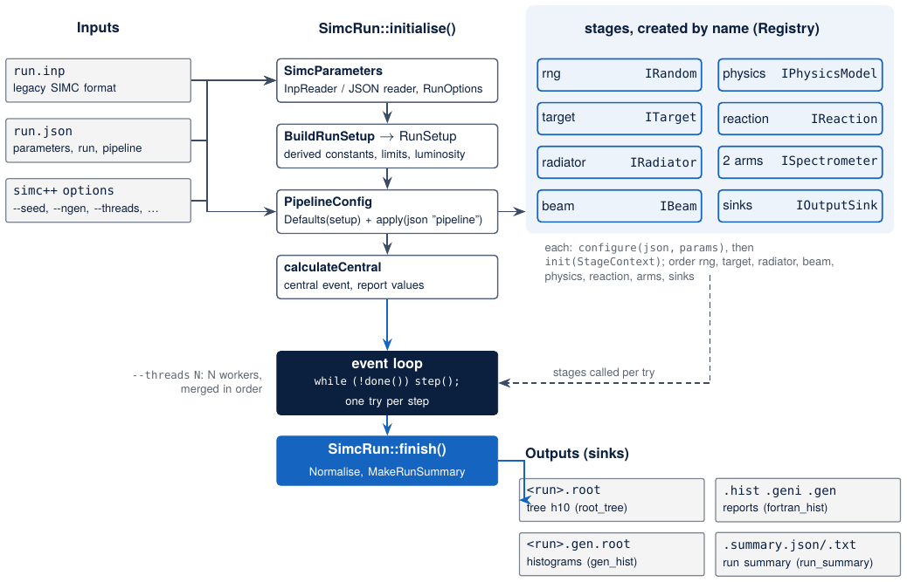
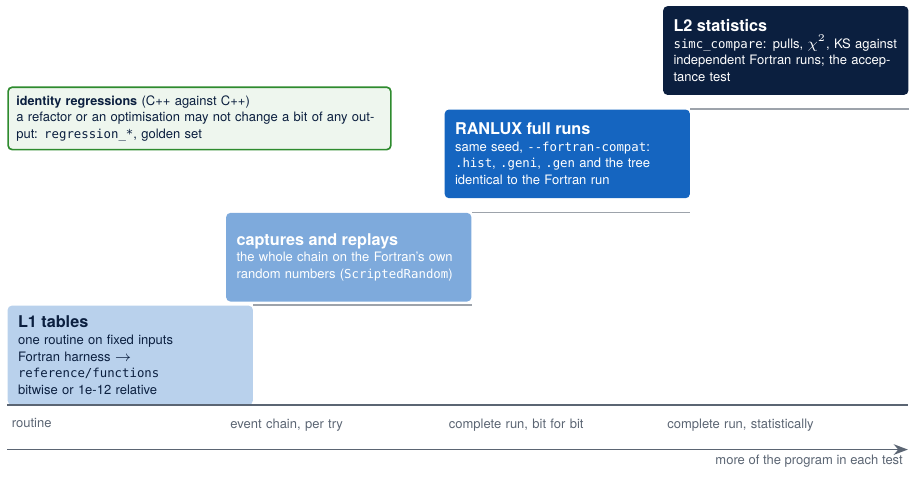

# 1. Introduction

## 1.1 What SIMC++ is

SIMC++ is a Monte Carlo for coincidence electron-scattering experiments A(e,e'X) with magnetic spectrometers (Jefferson Lab
Hall C, and the Hall A HRS). It generates events over a phase space matched to the spectrometer acceptances and weights
them with a physics model. Each event goes through:

* **beam and target**: beam energy spread, beam size and raster, energy loss and multiple scattering in the target and its
  windows, Coulomb correction;
* **reaction**: event generation and the cross section of the chosen physics model;
* **radiative corrections**: radiative tails of the incoming electron, the scattered electron and the hadron;
* **spectrometers**: optics maps, apertures, decay in flight, multiple scattering, detector resolution and reconstruction;
* **normalisation**: luminosity, generation volume and event weight, so that the weighted events give a yield for the
  simulated beam charge.

SIMC++ is not a detector simulation (GEANT4) and not a general background generator: events are generated only where the
spectrometers can see them.

It is a C++20 / ROOT 6 program, `simc++`. It reads the classic SIMC input files (`.inp`) as they are, or a JSON
configuration that can also choose the components ("plug-ins") of the simulation. It writes a ROOT tree with one entry per
accepted event, text reports and a JSON run summary ([chapter 7](07_outputs.md)).

(SIMC++ is a translation of the Fortran SIMC, `simc_gfortran`. The Fortran code is not needed to build or run it. How the
translation was validated is described in `docs/translation/`.)

## 1.2 What it simulates

| reaction (input flags) | targets | chapter |
|---|---|---|
| elastic and quasi-elastic (e,e'p) (no reaction flag) | H, D, nuclei (theory or Benhar spectral functions) | [5.2](05_reactions.md#52-heep-elastic-deep-and-aeep) |
| exclusive pion production (`doing_pion`): π+, π−, π0, Δ final states, coherent | H, D, nuclei | [5.3](05_reactions.md#53-exclusive-pion-production-doing_pion) |
| kaon electroproduction (`doing_kaon`): K+Λ, K+Σ0, K+Σ−, hypernuclei | H, D, nuclei | [5.4](05_reactions.md#54-kaon-electroproduction-doing_kaon) |
| (e,e'p)π in the Delta region (`doing_delta`) | H, D, nuclei | [5.5](05_reactions.md#55-eepπ-in-the-delta-region-doing_delta) |
| semi-inclusive (e,e'π±/π0)X and (e,e'K±)X (`doing_semi`) | H, D, nuclei | [5.6](05_reactions.md#56-semi-inclusive-production-doing_semi) |
| exclusive ρ0 → π+π− (`doing_rho`) | H, D, ³He | [5.7](05_reactions.md#57-exclusive-ρ0-production-doing_rho) |
| phase-space (acceptance) runs (`doing_phsp`) | any | [5.8](05_reactions.md#58-phase-space-and-acceptance-runs-doing_phsp) |

Spectrometers: HMS, SHMS, SOS, HRS-R, HRS-L and an NPS-like calorimeter arm with π0 → γγ detection; tracking through the
magnetic field of a polarized target ([chapter 6](06_spectrometers.md)).

## 1.3 Run modes

| mode | how | use |
|---|---|---|
| default | nothing to do | physics runs |
| legacy-compatible | `--fortran-compat`, optionally with the `ranlux` random-number generator | reproduce results of the legacy Fortran SIMC exactly, including its known bugs |

Both modes and the other run options (seeds, generators, threads) are described in
[chapter 8](08_running_and_reproducibility.md). The log line ` SIMC++: fortran_compat = false (...)` tells which mode a run
used.

## 1.4 Validation in one paragraph

Every physics routine was checked number for number against the original code, and complete runs of all the example
inputs distributed with SIMC reproduce the original output files exactly in the legacy-compatible mode. Default-mode runs
agree statistically, except where a known bug of the original is corrected. The test suite keeps this true for every
change ([2.6](02_installation.md#26-running-the-tests)); the evidence is in `docs/translation/`.

## 1.5 Limitations

* **Delta-region runs have no cross section in the weight** (no Delta model is implemented): the weight is phase space ×
  virtual-photon flux × a jacobian, so Delta yields are not physical rates ([5.5](05_reactions.md#55-eepπ-in-the-delta-region-doing_delta)).
* **Acceptance runs on hydrogen** keep the elastic kinematics, and radiation stays on unless `using_rad = 0`
  ([5.8](05_reactions.md#58-phase-space-and-acceptance-runs-doing_phsp)).
* **Model limitations**, for example: coherent pion and kaon production use the nucleon models; the ρ0 on D/³He has no
  Fermi motion; a π0 sent into the HMS/SHMS is transported like a charged particle. Each reaction section of
  [chapter 5](05_reactions.md) lists them.
* No `.bin` file and no PAW ntuple: the ROOT tree is written directly.
* The `debug(2..6)` diagnostic print-outs are not implemented ([4.6](04_inputs.md#46-parameter-reference)).
