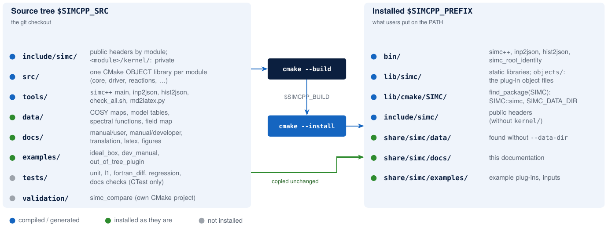

# 2. Installation

**SIMC++ is self-contained.** You do not need the Fortran SIMC, CERNLIB or any Fortran compiler to build, install or run it.
The model tables, optics maps and spectral functions it needs are part of SIMC++ (`data/`). The Fortran code and its
reference runs are used only by optional validation tests, which are skipped when those files are absent
([2.6](#26-running-the-tests)).

## 2.1 Directory layout used in this manual

All commands of this manual use these locations (adapt them to your machine):

| variable | example | content |
|---|---|---|
| `$SIMCPP_SRC` | `~/src/simcpp` | the git checkout of SIMC++ (the source tree) |
| `$SIMCPP_BUILD` | `~/build/simcpp` | the CMake build directory |
| `$SIMCPP_PREFIX` | `~/opt/simcpp` | the installation prefix (`bin/`, `lib/`, `include/`, `share/simc/data`) |
| `$SIMC_FORTRAN` | `~/src/simc_gfortran` | optional: the legacy Fortran SIMC, only for the validation tests |
| `$SIMC_REFERENCE` | `~/simc_reference` | optional: reference runs and tables of the legacy program, only for validation |
| `$ROOTSYS` | `~/opt/root` | the ROOT 6.40 installation |

```bash
export SIMCPP_SRC=~/src/simcpp SIMCPP_BUILD=~/build/simcpp SIMCPP_PREFIX=~/opt/simcpp
export ROOTSYS=~/opt/root LD_LIBRARY_PATH=$ROOTSYS/lib
export PATH=$SIMCPP_PREFIX/bin:$ROOTSYS/bin:$PATH
```

## 2.2 Requirements

| item | version | note |
|---|---|---|
| C++ compiler | C++20 (GCC 16.2 and clang 22 are used by the project; both build without warnings with `-Wall -Wextra -pedantic`) | |
| CMake | ≥ 3.15 | |
| ROOT | ≥ 6.40, built with C++20; components Core, Tree, Hist, RIO (the comparison tool also needs Gpad, Graf, MathCore) | the project uses ROOT 6.40.04 |
| nlohmann/json | ≥ 3.9 | downloaded automatically (FetchContent, v3.11.2) when it is not installed; this needs network access at configure time |
| Python 3 | any recent | only for the `docs` tests; they are not registered without Python |

Runtime library path: `LD_LIBRARY_PATH` must contain the `lib` directory of the ROOT that SIMC++ was built with, and no
directory with another ROOT or another `libtbb.so` (an older ROOT in `/usr/local/lib`, for example, breaks ROOT 6.40).

## 2.3 Building

```bash
cmake -S $SIMCPP_SRC -B $SIMCPP_BUILD -DCMAKE_PREFIX_PATH=$ROOTSYS -DCMAKE_BUILD_TYPE=Release
cmake --build $SIMCPP_BUILD -j8
```

The programs are in `$SIMCPP_BUILD/bin/`:

| program | purpose |
|---|---|
| `simc++` | the Monte Carlo |
| `inp2json` | converts a `.inp` input (and its `extra_dbase_file`) into a SIMC++ JSON configuration ([4.2](04_inputs.md#42-the-json-format)) |
| `hist2json` | converts a `.hist` + `.geni` report into the run-summary JSON format |
| `simc_root_identity` | compares two output ROOT files entry by entry and branch by branch (bitwise) |

CMake options:

| option | default | meaning |
|---|---|---|
| `CMAKE_BUILD_TYPE` | (none) | use `Release` (`-O3`). Do **not** add `-march=native` or `-ffast-math`: they change the floating-point results and the exact-reproduction tests then fail |
| `SIMC_BUILD_EXAMPLES` | `ON` | build the example plug-ins (`ideal_box`) into `simc++` |
| `SIMC_REFERENCE_DIR`, `SIMC_FORTRAN_DIR`, `SIMC_BASELINE_DIR` | the environment variables `SIMC_REFERENCE`, `SIMC_FORTRAN`, `SIMC_BASELINES`, else empty | **validation tests only**: the legacy reference data, the legacy source tree and the regression baselines. Not needed otherwise; when empty, the tests that need them are skipped ([2.6](#26-running-the-tests)) |

The statistical comparison tool `simc_compare` is a separate, optional CMake project in `validation/` (see
`docs/translation/user_comparing_with_fortran.md`).

## 2.4 Installing

```bash
cmake --install $SIMCPP_BUILD --prefix $SIMCPP_PREFIX
```

This installs:

* `$SIMCPP_PREFIX/bin/` with the four programs;
* `$SIMCPP_PREFIX/share/simc/data/` with the data files (optics maps, spectral functions, pion/kaon/SIDIS model tables, the
  target-field map, example configurations; each directory has an `MD5SUMS` file);
* `$SIMCPP_PREFIX/share/simc/docs/` (this manual and its example inputs in `docs/manual/user/examples/`),
  `$SIMCPP_PREFIX/share/simc/examples/` and `$SIMCPP_PREFIX/share/simc/README.md`;
* the headers, libraries and the CMake package `SIMC` (`find_package(SIMC)`), needed only to write your own plug-ins
  (developer manual).

With `$SIMCPP_PREFIX/bin` on the `PATH` the commands of this manual can be typed as `simc++ ...`. Without installing, use
`$SIMCPP_BUILD/bin/simc++`; both find their data automatically ([2.5](#25-where-the-data-files-are-found)).



## 2.5 Where the data files are found

`simc++` reads its tables from one data directory, the first of these that applies (`include/simc/core/DataPath.h`):

1. the environment variable `SIMC_DATA_DIR`, if it is set and not empty;
2. for a program built against the installed CMake package (`find_package(SIMC)`): that package's
   `<prefix>/share/simc/data`;
3. for an installed program (`<prefix>/bin/simc++`): `<prefix>/share/simc/data`, if it exists;
4. the source tree the program was built from (`<source>/data`), for in-tree builds and the tests.

`simc++ --print-data-dir` prints the directory it will use and exits:

```
$ simc++ --print-data-dir
~/opt/simcpp/share/simc/data
$ SIMC_DATA_DIR=/data/simc simc++ --print-data-dir
/data/simc
```

Two more ways to choose data files:

* `--data-dir DIR`: the directory of the spectral-function files of D/A(e,e'p), and the first place where a target-field
  map (`tgt_field_file`) is looked for (then the current directory, then the data directory's `field/`);
* the JSON keys `"data_dir"` (pion, kaon and SIDIS models) and `"matrix_dir"` (spectrometers) of a pipeline stage
  ([4.3](04_inputs.md#43-the-pipeline-section-choosing-plug-ins)).

> **Note:** a missing data file stops the run at start-up, not in the middle of a run.

## 2.6 Running the tests

```bash
cd $SIMCPP_BUILD
ctest -L docs                  # the user-manual checks (seconds)
ctest -L unit -j8              # the unit tests (no external data needed)
ctest -j8                      # everything
```

| label | what it tests | needs the validation data |
|---|---|---|
| `unit` | unit tests of the components | partly (many compare with reference tables) |
| `docs` | this manual: every input parameter and command-line option is documented, every link resolves | no |
| `examples`, `package` | the example plug-in; the installed CMake package used by an external project | yes (they run reference inputs) |
| `l1`, `replay` | each physics routine and complete runs against the original code's outputs | yes |
| `fortran_diff` | each documented difference with the original code, in both modes | partly |
| `cli` | the command line (input formats, rejected inputs) | partly |
| `regression`, `threads` | outputs of standard runs unchanged from the stored baselines; `--threads` reproducibility | yes |
| `regression_shipped`, `slow` | complete runs of the example inputs, identical to the original program's outputs (long) | yes |

Tests whose reference data, legacy source tree or baselines are missing report "Skipped", never "Failed": a build
configured without them runs the remaining tests (component self-tests, checksums of the shipped data files, the `docs`
tests) and skips the rest. To run the validation tests, export `SIMC_REFERENCE`, `SIMC_FORTRAN` and `SIMC_BASELINES` before
configuring (or pass the `-D` options of [2.3](#23-building)).

The project script `tools/check_all.sh [--commit REV] [--label NAME]` makes a clean build of SIMC++ and of the comparison
tool (with `ROOTSYS`, `SIMC_REFERENCE`, `SIMC_FORTRAN`, `SIMC_BASELINES` from the environment), runs both test suites and logs the result in a run folder (about 75 minutes, most of it in the
`slow` tests).
