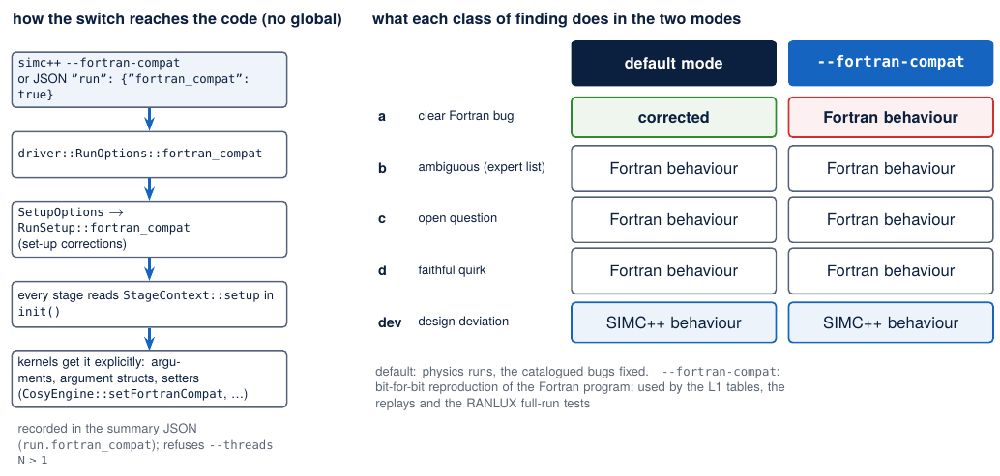
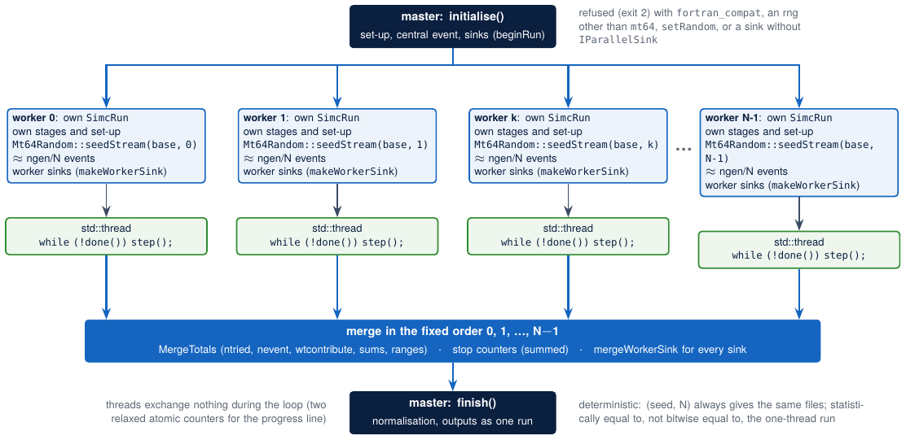

# 8. Running modes and reproducibility

## 8.1 Seeds

The seed comes from, in this order: the pipeline `"rng": {"seed": N}`, then `--seed N`, then the input's `random_seed`.
`--seed` overrides `random_seed`, and the `.hist` prints the overridden value. With the default generator:

* `random_seed > 0`: `std::mt19937_64` seeded with it;
* `random_seed = 0` or absent (and other values ≤ 0 except −1): the fixed seed 5489, so the run is still reproducible;
* `random_seed = −1`: the current time. The log line ` Use random seed = ...` shows the value.

A given input, seed, mode and number of threads always produce the same files.

## 8.2 Random-number generators: `mt64` and `ranlux`

| generator | pipeline | properties |
|---|---|---|
| `mt64` (default) | `"rng": "mt64"` or `{"type": "mt64", "seed": N}` | std::mt19937_64; fast; allows `--threads` |
| `ranlux` | `"rng": {"type": "ranlux"}`, optionally `"seed": N` or `"state": [25 integers]` | RANLUX at luxury level 3, the generator of the legacy SIMC, seeded from `random_seed` the same way. About 25 % slower. `"state"` takes the 25 integers of a saved generator state (a legacy `*_start_random_state.dat` file) |

## 8.3 Default and legacy-compatible mode

SIMC++ is a translation of the legacy Fortran SIMC. The legacy program has a number of known bugs (for example, the cut
that decides whether an event counts in the `.hist` yield uses the electron delta limit for the hadron). **The default
mode corrects them. The legacy-compatible mode, `--fortran-compat`, reproduces the legacy behaviour exactly**, bugs
included:

| | default | `--fortran-compat` |
|---|---|---|
| known bugs of the legacy SIMC | corrected | kept |
| with `ranlux`: identical output files to a legacy SIMC run of the same input | no | yes |
| `--threads N > 1` | yes | refused |
| use it for | physics | reproducing or checking an existing legacy SIMC result |

In a JSON input: `"run": {"fortran_compat": true}`. The log says which mode is active
(` SIMC++: fortran_compat = true (exact Fortran behaviour of upstream 59ccdf6, known Fortran bugs kept)`).

**Which legacy SIMC.** The legacy-compatible mode reproduces the official Fortran SIMC at commit 59ccdf6 (2026-10-01;
the file `UPSTREAM_SIMC`). That version fixed two of the known bugs itself (the kaon decay-product mass and the
H(e,e'π−)Δ++ stop), so the mode follows the fix. To reproduce a run of the older version 294f662 (2026-01-16) exactly,
add `--compat-target 294f662` (JSON `"run": {"compat_target": "294f662"}`; it has no effect without
`--fortran-compat`). A few 59ccdf6 problems are not reproduced in either target (the nuclear-elastic code removed by
mistake, the kaon ntuple stop, the pion 1/Z weight for A ≥ 3): see the translation report, chapter 7.

> **Legacy SIMC:** what each correction changes in the results, and which run types are affected, is listed in
> `docs/translation/markdown/user_differences.md`; how to compare SIMC++ with legacy SIMC runs statistically is in
> `docs/translation/markdown/user_comparing_with_fortran.md`.



## 8.4 Reproducing legacy SIMC results exactly

Run the same `.inp` with `ranlux`, `--fortran-compat` and one thread. The `.hist` (apart from its two time lines), the
`.geni`, the `.gen` and every entry of the tree are then identical to those of the legacy program. Example with a stored
legacy run (`$SIMC_REFERENCE/runs/...` are the project's reference runs; 1000 events, with an `extra_dbase_file`):

```bash
echo '{"pipeline": {"rng": {"type": "ranlux"}}}' > ranlux.json
R=$SIMC_REFERENCE/runs/eep_h_test_pctnames            # the legacy run: .inp, extra file, .hist, .geni, .gen, .root
simc++ $R/eep_h_test_pctnames.inp -o exact --fortran-compat --pipeline ranlux.json > exact.log
diff <(sed 2,3d exact/eep_h_test_pctnames.hist) <(sed 2,3d $R/eep_h_test_pctnames.hist) && echo ".hist: identical apart from the time lines"
cmp exact/eep_h_test_pctnames.geni $R/eep_h_test_pctnames.geni && cmp exact/eep_h_test_pctnames.gen $R/eep_h_test_pctnames.gen && echo ".geni, .gen: identical"
simc_root_identity exact/eep_h_test_pctnames.root $R/eep_h_test_pctnames.root | tail -1
```

Output:

```
.hist: identical apart from the time lines
.geni, .gen: identical
exact/eep_h_test_pctnames.root vs .../reference/runs/eep_h_test_pctnames/eep_h_test_pctnames.root: IDENTICAL
```

Notes:

* Use the same input, including its `random_seed` (none = the RANLUX default seed). Bit-for-bit identity also needs the
  same C math library (glibc `libm`) as the machine that made the legacy run.
* Without `--fortran-compat`, the `.hist` differs in the corrected lines (here two lines where the legacy program writes
  integers as `T`/`F`).
* This holds for every example input distributed with SIMC that the legacy program can run (CTest label
  `regression_shipped`).

## 8.5 Threads: `--threads N`

`--threads N` (or `"pipeline": {"threads": N}`; the option wins) runs the event loop on N threads
(`docs/manual/markdown/reference/PERFORMANCE.md` §3):

* each thread has its own copy of every stage and its own mt64 random stream, derived from (seed, thread number);
* the events are split: thread k makes ngen/N events (+1 for k < ngen mod N), so the total is exactly ngen (successes
  for ngen > 0, tries for ngen < 0);
* the outputs are merged in a fixed thread order: the tree entries thread after thread, the histograms and counters
  summed, the normalisation computed from the merged totals;
* **a given seed and N always give the same files**, but they are statistically equivalent to, not equal to, the
  one-thread run, or a run with another N. `--threads 1` is exactly the sequential run;
* the summary JSON records `"run": {"threads": N}`;
* the stage warnings of the threads may be interleaved in the log (`--quiet` silences them).

```
$ simc++ run.json -o out_t4 --ngen 5000 --threads 4 > out_t4.log; grep -E "Ntried|Ncontribute" out_t4/run.hist
            Ntried         =     102516
            Ncontribute    =       5000
$ simc++ run.json -o out_t4b --ngen 5000 --threads 4 > /dev/null && simc_root_identity out_t4/run.root out_t4b/run.root | tail -1
out_t4/run.root vs out_t4b/run.root: IDENTICAL
```

> **Warning:** `--threads N > 1` does not work with `--fortran-compat` or RANLUX: the exact reproduction of a legacy
> run needs one random stream consumed in the legacy order, and N threads use N streams. Both combinations are refused
> before the run starts (exit status 2):

```
$ simc++ run.json -o out_compat --ngen 5000 --threads 4 --fortran-compat
simc++: --threads 4 (more than one event-loop thread) cannot be used with --fortran-compat: the exact Fortran reproduction needs the single random stream in the Fortran order (run with --threads 1)
```

Statistical comparisons of 8-thread and one-thread runs agree (`docs/manual/markdown/reference/PERFORMANCE.md` §3).



## 8.6 Other run options

* `--ngen N` overrides `ngen` (use a small N for a test; a negative N gives |N| tries, which always ends).
* `--quiet` silences the stage messages (the progress lines stay).
* `--print-pipeline` prints the plug-ins chosen and continues with the run.
* `--run-name`, `-o`: output naming ([4.2.2](04_inputs.md#422-run)).
